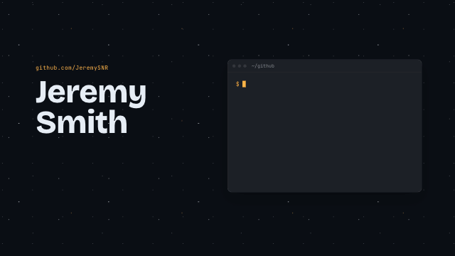
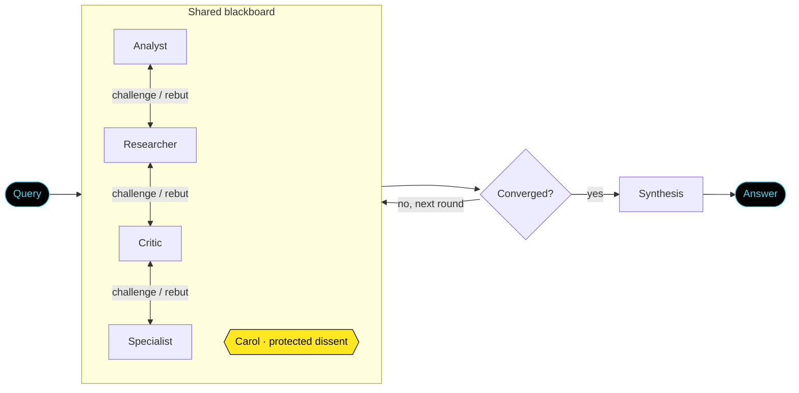

  

### ✦ *May the Source be with you* ✦

**AI researcher & engineer · multi-agent systems · collective reasoning · private AI · Leeds, UK**

---

### 📜 Episode X: The Private Stack

*It is a period of rented compute. Models live in other people's data centres,* 
*and every token arrives with an invoice.*

*Working from Leeds, one researcher studies how AI agents think together,* 
*and builds the platforms to run them, chasing a single question across every project:*

**what can run privately, and what do you end up renting?**

---

## 🔬 Research Division: Pluribus

> *E pluribus unum. Out of many, one.* 
> What does a group of models lose when everyone agrees, and how do you keep it honest?

**Pluribus** is my research programme on collective reasoning in multi-agent LLM systems: how agents share what they know, how a group converges on an answer, and how to stop it converging on the wrong one. It is named after the Apple TV+ series in which almost all of humanity joins a contented hive mind, and Carol is one of the few who will not.

<table>
<tr>
<th width="18%"></th>
<th width="41%">Phase 1 · <a href="https://github.com/JeremySNR/Pluribus">Blackboard Hive</a></th>
<th width="41%">Phase 2 · Latent Hive</th>
</tr>
<tr>
<td><b>Channel</b></td>
<td>Natural-language contributions on a shared blackboard</td>
<td>A shared, continuous-valued latent buffer. Agents communicate without text</td>
</tr>
<tr>
<td><b>Dynamics</b></td>
<td>Cross-inhibition: challenges and rebuttals reweight agents each round, with decay toward equality and a floor so no one is fully silenced</td>
<td>BAPC codecs into the buffer, TIES-Resolve conflict resolution, damped fixed-point iteration to a stable state</td>
</tr>
<tr>
<td><b>Core idea</b></td>
<td><b>Carol</b>, a structurally protected dissenter. The hive can ignore her, but it cannot suppress her</td>
<td>Agents share representations, not sentences</td>
</tr>
<tr>
<td><b>Evidence</b></td>
<td>30-task suite (factual, adversarial with planted errors, complex judgment) against single-agent, majority-vote and ensemble baselines</td>
<td>Emergent collective representations confirmed at <b>GPT-2</b> and <b>7B</b> scale</td>
</tr>
<tr>
<td><b>Status</b></td>
<td> </td>
<td></td>
</tr>
</table>

**Open questions I am working on**

- Can agents reason together through something richer than text, and what does that shared representation look like?
- Is dissent more useful as a structural guarantee than as a prompt?
- When does a hive beat one strong model, and when is it just expensive voting?

Also from the lab: <a href="https://github.com/JeremySNR/notes-for-future-agents"><b>notes-for-future-agents</b></a>, field notes left by one agent for the next on staying in scope, spotting impossible tasks and knowing when to ask a human. Released as a CC0 dataset.

---

## 🛰️ Currently in Hyperspace

<table>
<tr>
<td width="45%" valign="middle">

</td>
<td width="55%" valign="middle">

### 🎬 [Cutawan](https://github.com/JeremySNR/cutawan)

**The free, open-source desktop alternative to Opus Clip.**

Podcasts, webinars, streams and interviews in, ready-to-post vertical clips out. AI-picked moments, virality scores, animated captions, auto zoom and speaker-aware reframing. Your footage never leaves your machine. No subscription, no upload, no cap on minutes.

**[Download for macOS, Windows or Linux](https://github.com/JeremySNR/cutawan/releases/latest)** · [cutawan.xyz](https://cutawan.xyz)

</td>
</tr>
</table>

<table>
<tr>
<td width="50%" valign="top">

### 🧬 [Metachlorian](https://github.com/JeremySNR/Metachlorian)

**Shot-level footage search for AI video editors.** It watches your footage once, on your own hardware, and builds an index agents can query over MCP in milliseconds. *"A two-second cutaway of a yellow cab, panning left, no faces."* Exports to OTIO, FCPXML and EDL, and hands shots straight to Cutawan.

[Site](https://metachlorian.vercel.app) · [Community index](https://github.com/JeremySNR/Metachlorian-community)

</td>
<td width="50%" valign="top">

### 🪶 [Quillgon](https://github.com/JeremySNR/quillgon)

**A whole novel. Still your story.** A local, open-source writing desk that plans, drafts and revises a full-length novel with AI, with story planning, continuity tracking and reviewed revisions. Every change is a git commit, and it works offline.

[Site](https://quillgon.vercel.app) · [Releases](https://github.com/JeremySNR/quillgon/releases)

</td>
</tr>
</table>

---

## 🗄️ The Jedi Archives

<table>
<tr>
<td width="50%" valign="top">

#### 📦 [snug](https://github.com/JeremySNR/snug)
Zero-dependency TypeScript primitive for fitting prioritised content into a token budget. Atomic tool pairs, required items, and a validated result you can hand straight to a model. 
Adapters: [openai](https://github.com/JeremySNR/snug-openai) · [anthropic](https://github.com/JeremySNR/snug-anthropic) · [tiktoken](https://github.com/JeremySNR/snug-tiktoken)

</td>
<td width="50%" valign="top">

#### 🔀 [converge](https://github.com/JeremySNR/converge)
Convert LLM message arrays between provider formats. OpenAI, Anthropic and Gemini, in either direction. Pure data transformation, no API calls.

</td>
</tr>
<tr>
<td width="50%" valign="top">

#### 🏛️ [Project Foundry](https://github.com/JeremySNR/Project-foundry)
The governance layer for AI coding agents. Raw tickets in, reviewed pull requests out. Every step policy-gated, human-approved and audited: the agent is the muscle, Foundry is the brain and the seatbelt.

</td>
<td width="50%" valign="top">

#### 🎨 [ashla-lightroom](https://github.com/JeremySNR/ashla-lightroom)
AI colour grading for Lightroom Classic. Describe a look, hand it a reference photo, or let it choose. Ashla reads your image and applies the result as a develop preset.

</td>
</tr>
</table>

---

## 📡 Transmissions

I write at **[jeremysnr.github.io](https://jeremysnr.github.io)** about AI infrastructure, sovereign compute and the industrial decisions Britain is making, or failing to make.

<!-- LATEST-POST:START -->
Latest: [Now we have the full details, here's what happened, and here's why it terrifies me](https://jeremysnr.github.io/2026/09/now-we-have-the-full-details/)
<!-- LATEST-POST:END -->

---

## ⚔️ The Armoury

  
  
  
  
  
  
   
  
  
  
  
  
  

---

## 📊 Holonet Telemetry

---

*Building AI systems that are intelligent, private, and actually useful.*

